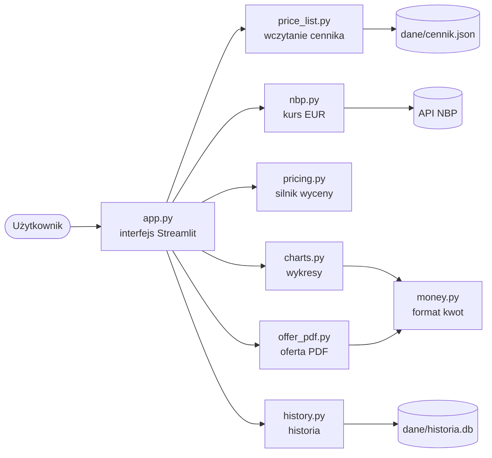
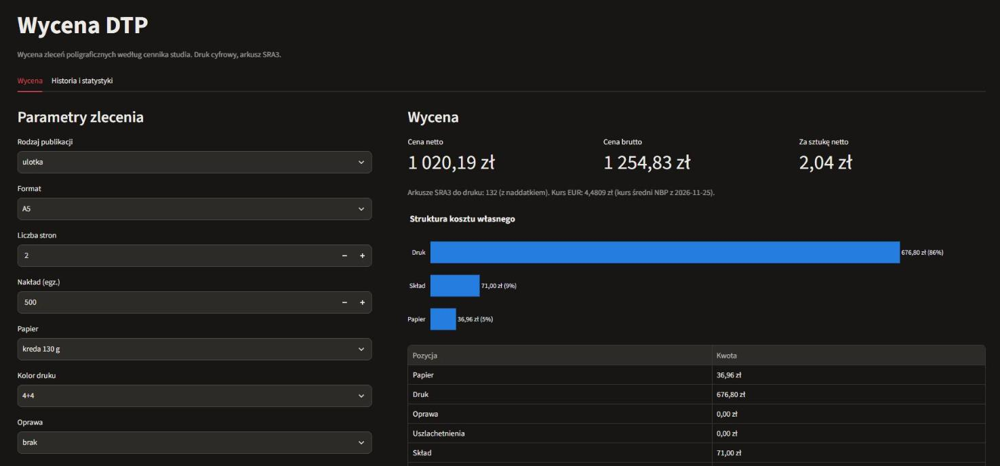
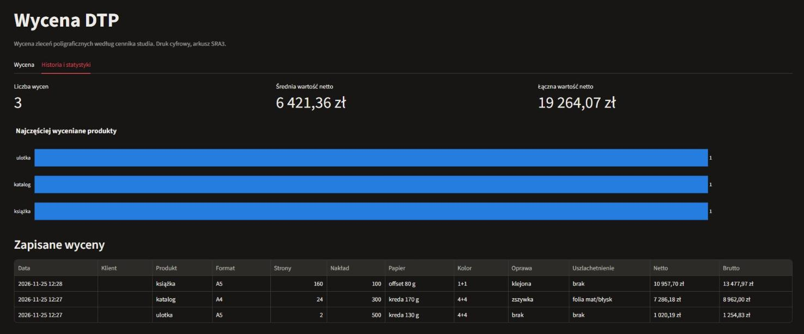
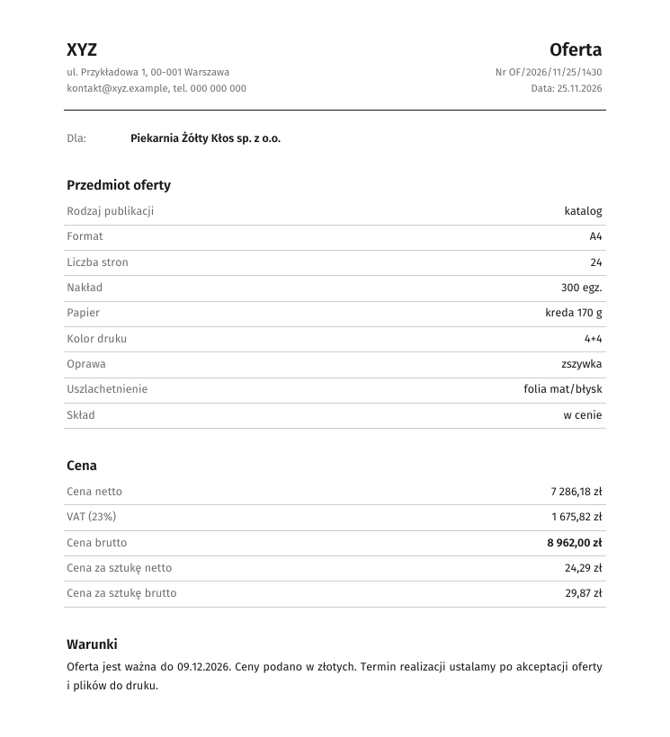

# Wycena DTP: dokumentacja projektu

Projekt zaliczeniowy z przedmiotu **Advanced Python for Business**
Prowadzący: mgr Piotr Żmijewski
Autor: Jakub Ciągło, Uczelnia Łazarskiego, Zarządzanie, specjalność AI w biznesie, studia niestacjonarne
Repozytorium: https://github.com/ciagloo/wycena-dtp

## Spis treści

1. [Problem biznesowy](#1-problem-biznesowy)
2. [Użytkownik i scenariusz użycia](#2-użytkownik-i-scenariusz-użycia)
3. [Funkcje aplikacji](#3-funkcje-aplikacji)
4. [Architektura](#4-architektura)
5. [Logika wyceny](#5-logika-wyceny)
6. [Dane](#6-dane)
7. [Instrukcja obsługi](#7-instrukcja-obsługi)
8. [Instalacja i uruchomienie](#8-instalacja-i-uruchomienie)
9. [Testy i jakość kodu](#9-testy-i-jakość-kodu)
10. [Ograniczenia i możliwe rozwinięcia](#10-ograniczenia-i-możliwe-rozwinięcia)
11. [Realizacja wymagań](#11-realizacja-wymagań)

## 1. Problem biznesowy

W małym studiu DTP wyceny zleceń poligraficznych (papier, druk, oprawa, uszlachetnienia, skład)
przygotowuje się ręcznie, w arkuszu kalkulacyjnym lub na kartce. Powoduje to trzy problemy:

- **czas**: każda wycena wymaga ręcznego liczenia arkuszy i kosztów, a oferta dla klienta powstaje osobno;
- **niespójność**: to samo zlecenie wycenione przez dwie osoby albo w różnych dniach może mieć inną cenę;
- **błędy**: kwoty przepisywane do oferty ręcznie łatwo pomylić.

Aplikacja liczy cenę według jednego cennika i jednego algorytmu, pokazuje strukturę kosztów
i od razu generuje ofertę PDF. Te same parametry zawsze dają tę samą cenę.

Autor zna ten proces z pracy na stanowisku koordynatora zleceń w studiu DTP.

## 2. Użytkownik i scenariusz użycia

Użytkownikiem jest koordynator zleceń lub właściciel małego studia DTP. Nie musi znać Pythona:
z aplikacji korzysta w przeglądarce, a stawki zmienia w pliku tekstowym z cennikiem.

1. Klient pyta o cenę, np. 300 katalogów A4, 24 strony, kreda 170 g, druk kolorowy, zszywka, folia na okładce.
2. Koordynator wybiera rodzaj publikacji. Formularz podstawia typowe parametry, które można zmienić.
3. Aplikacja liczy koszt każdej składowej, dolicza marżę i VAT, pokazuje wykres kosztów.
4. Koordynator wpisuje nazwę klienta, pobiera ofertę PDF i wysyła ją klientowi.
5. Wycena trafia do historii, z której powstają statystyki sprzedażowe.

## 3. Funkcje aplikacji

| Funkcja | Opis | Moduł |
| --- | --- | --- |
| Formularz zlecenia | rodzaj publikacji, format, liczba stron, nakład, papier, kolor, oprawa, uszlachetnienie, skład | `app.py` |
| Parametry domyślne | wybór produktu podstawia typowe parametry (np. książka: A5, 160 stron, oprawa klejona) | `app.py`, `cennik.json` |
| Kontrola wykonalności | odrzuca zlecenia niewykonalne, np. zszywkę przy 348 stronach | `pricing.py` |
| Silnik wyceny | papier, druk z progami ilościowymi, oprawa, uszlachetnienia, skład, marża, VAT | `pricing.py` |
| Cennik w pliku | wszystkie stawki w `dane/cennik.json`, zmiana bez edycji kodu | `price_list.py` |
| Wykres kosztów | udział każdej składowej w koszcie własnym | `charts.py` |
| Oferta PDF | parametry i cena dla klienta, bez kosztów wewnętrznych i marży | `offer_pdf.py` |
| Historia i statystyki | zapis w SQLite, liczba wycen, średnia i łączna wartość, najczęstsze produkty | `history.py` |
| Kurs EUR z NBP | aktualny kurs do papierów wycenianych w euro, z kursem awaryjnym | `nbp.py` |

## 4. Architektura

Aplikacja jest podzielona na moduły według odpowiedzialności. Interfejs (`app.py`) nie zawiera
obliczeń: wywołuje funkcje z pakietu `wycena`. Dzięki temu logikę można testować bez interfejsu.



### Struktura plików

```
wycena-dtp/
    app.py                        interfejs użytkownika (Streamlit)
    wycena/                       logika aplikacji
        pricing.py                silnik wyceny i walidacja zlecenia
        price_list.py             wczytanie i kontrola cennika
        offer_pdf.py              oferta PDF (fpdf2)
        history.py                historia wycen (SQLite) i statystyki (pandas)
        nbp.py                    kurs EUR z API NBP (requests)
        charts.py                 wykresy (Plotly)
        money.py                  formatowanie kwot
    dane/
        cennik.json               stawki, marża, VAT, dane studia, parametry produktów
        przykladowe_zlecenia.json 11 zleceń przykładowych
        ZRODLA_CEN.md             źródła stawek i sposób uśrednienia
        fonty/                    Fira Sans (licencja OFL) do oferty PDF
    tests/                        36 testów jednostkowych (pytest)
    docs/DOKUMENTACJA.md          ten dokument
    docs/img/                     zrzuty ekranu do dokumentacji
    .github/workflows/testy.yml   automatyczne testy na GitHubie (CI)
    Dockerfile                    uruchomienie w kontenerze
    pyproject.toml                konfiguracja ruff i pytest
    requirements.txt              biblioteki
```

### Użyte technologie

| Technologia | Zastosowanie |
| --- | --- |
| Python 3.12 (wymagany 3.10+) | język programowania |
| Streamlit | interfejs w przeglądarce |
| pandas | tabele i statystyki |
| Plotly | wykresy |
| fpdf2 | generowanie PDF |
| SQLite (moduł `sqlite3`) | baza historii wycen |
| requests | zapytania do API NBP |
| pytest | testy jednostkowe |
| ruff | linter (PEP 8) i formatowanie |
| Git, GitHub, GitHub Actions | wersjonowanie i automatyczne testy |
| Docker | konteneryzacja |

## 5. Logika wyceny

Model zakłada **druk cyfrowy na arkuszach SRA3** (320 x 450 mm), typowy dla małych i średnich
nakładów w studiu DTP. Cała logika znajduje się w `wycena/pricing.py`.

### Krok po kroku

1. **Kontrola zlecenia** (`sprawdz_zlecenie`): nakład i liczba stron co najmniej 1; wybrane opcje istnieją
   w cenniku; druk jednostronny (np. 4+0) tylko dla 1 strony; przy oprawie liczba stron podzielna przez 4
   i w zakresie danej oprawy.
2. **Liczba arkuszy** (`liczba_arkuszy`, `z_naddatkiem`):
   arkusze = ⌈ nakład × liczba stron / (użytki na arkuszu × strony zadrukowane na arkuszu) ⌉,
   następnie + 5% naddatku na próby i odpady, w górę do pełnego arkusza.
   Użytki to liczba stron danego formatu na jednej stronie arkusza (A4: 2, A5: 4, wizytówka: 21).
3. **Papier**: arkusze × cena arkusza. Ceny w euro przeliczane po kursie NBP (`cena_arkusza_papieru`).
4. **Druk**: arkusze × stawka za kolor + opłata za przygotowanie zlecenia. Stawka zależy od progu
   ilościowego: od 1, od 100 i od 500 arkuszy (`stawka_druku`).
5. **Oprawa**: nakład × stawka za egzemplarz.
6. **Uszlachetnienia**: arkusze × stawka + opłata za przygotowanie. W publikacji oprawionej
   uszlachetniana jest tylko okładka (4 strony egzemplarza).
7. **Skład**: liczba stron × stawka za stronę; koszt stały, niezależny od nakładu.
8. **Ceny końcowe**: koszt własny = suma składowych; netto = koszt własny + marża (30%);
   brutto = netto + VAT (23%); cena za sztukę = cena / nakład.

### Przykład 1: 500 ulotek A5, 2 strony, kreda 130 g, 4+4

| Pozycja | Obliczenie | Kwota |
| --- | --- | --- |
| Arkusze | 500 × 2 / (4 × 2) = 125, + 5% = 131,25, w górę: 132 | 132 ark. |
| Papier | 132 × 0,28 zł | 36,96 zł |
| Druk | 132 × 4,90 zł (próg od 100 ark.) + 30,00 zł | 676,80 zł |
| Skład | 2 strony × 35,50 zł | 71,00 zł |
| Koszt własny | | 784,76 zł |
| Marża 30% | | 235,43 zł |
| **Cena netto** | | **1 020,19 zł** |
| VAT 23% | | 234,64 zł |
| **Cena brutto** | | **1 254,83 zł** |
| Za sztukę netto | 1 020,19 / 500 | 2,04 zł |

### Przykład 2: 300 katalogów A4, 24 strony, kreda 170 g, 4+4, zszywka, folia na okładce

| Pozycja | Obliczenie | Kwota |
| --- | --- | --- |
| Arkusze | 300 × 24 / (2 × 2) = 1 800, + 5% = 1 890 | 1 890 ark. |
| Papier | 1 890 × 0,40 zł | 756,00 zł |
| Druk | 1 890 × 1,85 zł (próg od 500 ark.) + 30,00 zł | 3 526,50 zł |
| Oprawa | 300 × 0,15 zł | 45,00 zł |
| Folia (okładka) | 300 × 4 / 4 = 300 ark., + 5% = 315 ark. × 1,35 zł | 425,25 zł |
| Skład | 24 strony × 35,50 zł | 852,00 zł |
| Koszt własny | | 5 604,75 zł |
| **Cena netto** | koszt własny + 30% | **7 286,18 zł** |
| **Cena brutto** | netto + 23% | **8 962,00 zł** |
| Za sztukę netto | 7 286,18 / 300 | 24,29 zł |

## 6. Dane

### Cennik (`dane/cennik.json`)

Wszystkie stawki są w jednym pliku JSON, który można zmienić w zwykłym edytorze tekstu.
Nowa pozycja (np. papier) od razu pojawia się w formularzu. Najważniejsze sekcje:

| Sekcja | Zawartość |
| --- | --- |
| `marza_procent`, `vat_procent`, `naddatek_procent` | parametry ogólne |
| `produkty` | rodzaje publikacji i ich typowe parametry |
| `uzytki_na_arkuszu` | ile stron danego formatu mieści arkusz SRA3 |
| `papiery` | cena arkusza i waluta (PLN lub EUR) |
| `druk_za_arkusz` | progi ilościowe ze stawkami dla kolorów 4+4, 4+0, 1+1, 1+0 |
| `oprawy_za_egzemplarz`, `limity_stron_oprawy` | stawki i zakresy stron opraw |
| `uszlachetnienia` | stawka za arkusz i opłata za przygotowanie |
| `studio`, `waznosc_oferty_dni` | dane do oferty PDF |

Przy uruchomieniu `price_list.py` sprawdza, czy cennik ma wszystkie wymagane sekcje.

### Źródła stawek (`dane/ZRODLA_CEN.md`)

Stawki to średnie arytmetyczne z publicznych cenników polskich drukarni, hurtowni papieru
i studiów graficznych (listopad 2026). Plik wymienia każde źródło i każdą uśrednianą wartość.
Cennik jest przykładowy i nie odzwierciedla stawek żadnego konkretnego studia.

### Dane przykładowe (`dane/przykladowe_zlecenia.json`)

11 zleceń obejmujących wszystkie produkty, formaty, oprawy, uszlachetnienia i papiery w euro.
Test `test_wszystkie_przykladowe_zlecenia_da_sie_wycenic` sprawdza, że każde z nich daje poprawną wycenę.

### Historia (`dane/historia.db`)

Baza SQLite tworzona automatycznie przy pierwszym zapisie. Tabela `wyceny` przechowuje datę, klienta,
parametry zlecenia oraz cenę netto i brutto. Plik nie trafia do repozytorium (`.gitignore`).

### Dane zewnętrzne: API NBP

Kurs średni EUR z tabeli A: `https://api.nbp.pl/api/exchangerates/rates/a/eur/?format=json`.
Aplikacja zapamiętuje kurs na godzinę. Gdy API nie odpowie w ciągu 5 sekund lub zwróci dane
w nieoczekiwanym formacie, używany jest kurs awaryjny z cennika, a interfejs o tym informuje.

## 7. Instrukcja obsługi

### Zakładka „Wycena”

1. Wybierz **rodzaj publikacji**. Formularz podstawi typowe parametry.
2. Dostosuj parametry: format, liczbę stron, nakład, papier, kolor, oprawę, uszlachetnienie.
   Odznacz „Skład wykonuje studio”, jeśli klient dostarcza gotowe pliki.
3. Po prawej stronie od razu pojawia się wycena: cena netto, brutto i za sztukę, liczba arkuszy,
   kurs EUR, wykres struktury kosztów i tabela z marżą i VAT.
4. Jeśli zlecenie jest niewykonalne, zamiast wyceny pojawi się komunikat z przyczyną.
5. Wpisz nazwę klienta i kliknij **Pobierz ofertę PDF**.
6. Kliknij **Zapisz w historii**, aby dodać wycenę do statystyk.



### Zakładka „Historia i statystyki”

Liczba zapisanych wycen, średnia i łączna wartość netto, wykres najczęściej wycenianych produktów
i tabela wszystkich wycen od najnowszej.



### Oferta PDF

Zawiera dane studia, numer (z daty i godziny), datę, klienta, parametry zlecenia, ceny netto,
VAT, brutto i za sztukę oraz termin ważności (14 dni). **Nie zawiera** kosztów wewnętrznych
ani marży, bo to informacje tylko dla studia.



## 8. Instalacja i uruchomienie

Wymagany Python 3.10 lub nowszy.

### Windows (PowerShell)

```
git clone https://github.com/ciagloo/wycena-dtp.git
cd wycena-dtp
python -m venv .venv
.venv\Scripts\Activate.ps1
pip install -r requirements.txt
streamlit run app.py
```

### macOS / Linux

```
git clone https://github.com/ciagloo/wycena-dtp.git
cd wycena-dtp
python3 -m venv .venv
source .venv/bin/activate
pip install -r requirements.txt
streamlit run app.py
```

Aplikacja otworzy się w przeglądarce pod adresem http://localhost:8501.

### Docker

```
docker build -t wycena-dtp .
docker run -p 8501:8501 wycena-dtp
```

## 9. Testy i jakość kodu

### Testy jednostkowe

```
python -m pytest
```

| Plik | Liczba testów | Co sprawdza |
| --- | --- | --- |
| `test_pricing.py` | 17 | liczenie arkuszy, naddatek, progi ilościowe, przeliczenie EUR, pełne wyceny, odrzucanie błędnych zleceń |
| `test_offer_pdf.py` | 5 | numer i termin ważności oferty, twarda spacja, poprawność pliku PDF |
| `test_history.py` | 4 | zapis i odczyt z bazy, kolejność, statystyki |
| `test_nbp.py` | 4 | odczyt kursu, brak połączenia, błędny format odpowiedzi |
| `test_price_list.py` | 3 | wczytanie cennika, brakujące pola, wycena wszystkich zleceń przykładowych |
| `test_charts.py` | 2 | dane na wykresach |
| `test_money.py` | 1 | formatowanie kwot |

Testy silnika korzystają z uproszczonego cennika z okrągłymi stawkami, więc każdy wynik można
sprawdzić ręcznie. Testy bazy używają tymczasowego pliku (`tmp_path`), a testy NBP podmieniają
zapytanie sieciowe (`monkeypatch`), więc działają bez internetu.

### Jakość kodu

- **PEP 8**: sprawdzany linterem ruff (`ruff check .`), konfiguracja w `pyproject.toml`.
- **Type hints**: wszystkie funkcje mają opisane typy argumentów i wyniku.
- **Docstringi** po polsku przy każdym module i funkcji.
- **CI**: GitHub Actions uruchamia linter i testy po każdym `git push`.

## 10. Ograniczenia i możliwe rozwinięcia

### Ograniczenia

- Model obejmuje tylko druk cyfrowy. Przy dużych nakładach (powyżej ok. 1000 egz.) tańszy jest offset.
- Okładka jest drukowana na tym samym papierze co środek publikacji.
- Na granicy progu ilościowego cena spada skokowo, np. 499 arkuszy kosztuje więcej niż 500.
- Aplikacja sprawdza wykonalność techniczną, ale nie reguły handlowe (np. „książka wymaga oprawy”).

### Możliwe rozwinięcia

- Osobny papier i kolor dla okładki.
- Wycena offsetowa i automatyczny wybór tańszej technologii.
- Wybór tańszego wariantu na granicy progu (np. 500 arkuszy zamiast 499).
- Logowanie użytkowników i historia per koordynator.
- Eksport historii do Excela.

## 11. Realizacja wymagań

| Wymaganie | Realizacja |
| --- | --- |
| Działająca aplikacja w Pythonie 3.10+ | Streamlit, uruchamiana jednym poleceniem |
| Problem biznesowy | wycena zleceń i oferty w małym studiu DTP (rozdział 1) |
| Dokumentacja | README, ten dokument, `ZRODLA_CEN.md` |
| Dane przykładowe | cennik i 11 zleceń przykładowych |
| Repozytorium Git | GitHub, historia commitów dla każdego etapu |
| Testy jednostkowe | 36 testów pytest |
| Interfejs użytkownika | Streamlit, dwie zakładki |
| Wizualizacja wyników | wykres struktury kosztów i wykres produktów (Plotly) |
| Zewnętrzne źródło danych | API NBP |
| Jakość kodu | PEP 8, type hints, linter ruff |
| Konteneryzacja / CI | Dockerfile, GitHub Actions |
